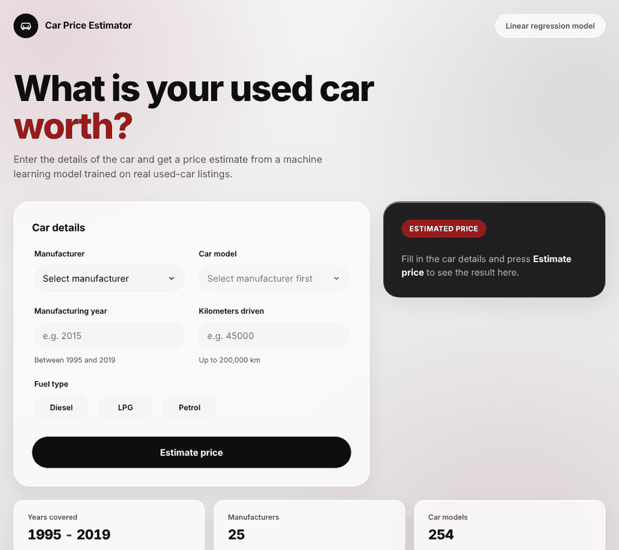
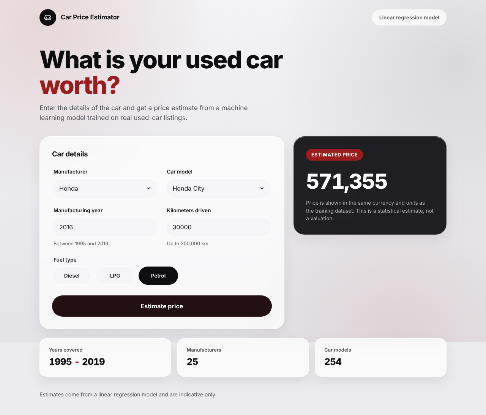
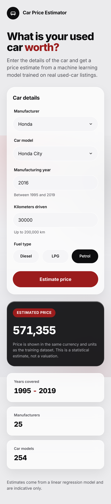
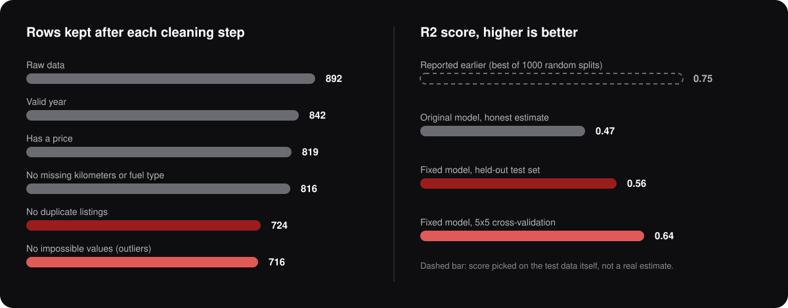

<p align="center">
  
</p>

<p align="center">
  
  
  
  
</p>

**Live demo:** https://car-price-predictor-nine.vercel.app/

A used-car price predictor. A linear regression model trained on Quikr listings sits behind a small Flask API, and a responsive web page lets anyone enter a car's details and get a price estimate.

<p align="center">
  
</p>

## Screenshots

<p align="center">
  
  &nbsp;
  
</p>

## Contents

- [Screenshots](#screenshots)
- [How it works](#how-it-works)
- [Data and cleaning](#data-and-cleaning)
- [Model](#model)
- [Getting started](#getting-started)
- [API](#api)
- [Retraining the model](#retraining-the-model)
- [Deploying to Vercel](#deploying-to-vercel)
- [Project structure](#project-structure)
- [Limitations](#limitations)
- [License](#license)

## How it works

<p align="center">
  
</p>

1. The notebook cleans `quikr_car.csv`, trains the model, and saves `cleaned_quikr_car.csv` and `LinearRegression.pkl`.
2. `app.py` loads the model and builds the form options (manufacturers, car models, fuel types, valid ranges) from `cleaned_quikr_car.csv`, so the form always matches what the model was trained on.
3. The web page sends the form to `POST /predict`. The API validates the input, runs the model, and returns the estimate.

## Data and cleaning

The raw dataset has 892 listings and several problems. The notebook fixes each one and keeps 716 rows.

<p align="center">
  
</p>

| Problem found | Fix |
|---|---|
| `year` holds junk text (for example `TOUR`, `sale`) and is stored as text | Keep real 4-digit years, convert to integer |
| `Price` has `Ask For Price` and values like `4,25,000` stored as text | Drop those listings, strip commas, convert to integer |
| `kms_driven` is text like `45,000 kms`, and some values are `Petrol` or missing | Strip text, convert to integer, drop invalid rows |
| `fuel_type` has missing values | Drop those rows |
| 92 exact duplicate listings | Remove them, so they cannot leak between train and test |
| Impossible values: a 2006 Jeep with 40 km, a 2012 Innova with 0 km, a car with 400,000 km, an XUV500 at 8,500,003 | Remove by rule (price under 6,000,000, at most 250,000 km, no near-zero kilometers on cars three or more years old) |
| 460 distinct full listing titles for about 700 rows | Keep the first three words of each name (254 names), so the model can learn from them |

## Model

- Features: `name`, `company`, `year`, `kms_driven`, `fuel_type`
- Preprocessing: one-hot encoding for `name`, `company` and `fuel_type` (unknown values are ignored), `log1p` for `kms_driven`, `year` passed through
- Estimator: `LinearRegression`, fitted on `log(price)` and converted back with `exp`, which also keeps estimates positive
- Final model: fitted on all 716 rows

### Accuracy

| Measure | Value |
|---|---|
| R2 on a held-out 20% test set | 0.56 |
| R2, 5x5 repeated cross-validation | 0.64 |
| Median absolute error | about 46,350 (about 16% of the median price) |

R2 is the share of price variation the model explains, so 0.56 is not "56% accuracy". An earlier version of the notebook reported 0.75, but that was the best of 1000 random train/test splits, which is picking the score on the test data. The honest estimate for that original model was about 0.47. The dashed bar in the chart above marks that number.

### Models compared

All models use the same cleaned data, features and split.

| Model | R2 (held-out) | Median absolute error |
|---|---|---|
| Linear regression (log price, log kms) | **0.557** | **46,350** |
| Ridge regression | 0.539 | 51,992 |
| Gradient boosting | 0.498 | 64,498 |
| Extra trees | 0.350 | 55,238 |
| Random forest | 0.365 | 71,849 |

With 716 rows and 254 car names, most names appear only a few times. The tree models memorise them instead of generalising, so plain linear regression wins and is also the smallest file.

### Which features matter

Cross-validated R2 loss when one feature is removed (full model: 0.636):

| Feature removed | R2 loss |
|---|---|
| `year` | 0.329 |
| `company` | 0.199 |
| `name` | 0.039 |
| `fuel_type` | 0.001 |
| `kms_driven` | -0.014 |

Price is driven mostly by manufacturer and year. In this dataset kilometers and fuel type add almost nothing; listing kilometers are typed in by sellers and are noisy. Differences below about 0.02 are within the noise between folds.

## Getting started

The project was developed on Python 3.14, and the exact package versions are in `requirements.txt`.

```bash
git clone https://github.com/alaa-m0hammed/CAR-PRICE-PREDICTOR.git
cd CAR-PRICE-PREDICTOR

python3 -m venv .venv
source .venv/bin/activate        # Windows: .venv\Scripts\activate
pip install -r requirements.txt

python app.py
```

Open http://127.0.0.1:5002 in your browser.

`scikit-learn` is pinned to the same version that saved `LinearRegression.pkl`. A different version can load the model with warnings or fail.

## API

The page calls this endpoint, and you can call it yourself.

`POST /predict` with form fields:

| Field | Type | Allowed values |
|---|---|---|
| `company` | string | One of the 25 manufacturers in the dataset |
| `name` | string | A car model that belongs to the chosen manufacturer (254 in total) |
| `year` | integer | 1995 to 2019 |
| `kms_driven` | integer | 0 to 200,000 |
| `fuel_type` | string | `Petrol`, `Diesel` or `LPG` |

```bash
curl -X POST http://127.0.0.1:5002/predict \
  -H "X-Requested-With: fetch" \
  -d "company=Honda" -d "name=Honda City" \
  -d "year=2016" -d "kms_driven=30000" -d "fuel_type=Petrol"
```

```json
{"ok": true, "prediction": {"reliable": true, "value": 571355}}
```

Invalid input returns status 400 with the problem per field:

```json
{"ok": false, "errors": {"year": "Enter a year between 1995 and 2019."}}
```

Without the `X-Requested-With: fetch` header the endpoint returns the HTML page with the result, so the form also works when JavaScript is disabled. `reliable` is `false` when the model returns a value of zero or below, which means the car is outside the range it estimates well.

The price has no currency label, see [Limitations](#limitations).

## Retraining the model

Open [quikr_predictor XY.ipynb](quikr_predictor%20XY.ipynb) in a folder that contains `quikr_car.csv` and run all cells. It writes new `cleaned_quikr_car.csv` and `LinearRegression.pkl` files next to it. Restart the app afterwards, and the form options update on their own. Keep the scikit-learn version in `requirements.txt` the same as the one you train with.

## Deploying to Vercel

The project is set up for Vercel's zero-configuration Flask support.

- `app.py` is the entrypoint and exposes the Flask `app`.
- `requirements.txt` lists the dependencies, and `.python-version` selects Python 3.14.
- Vercel does not serve Flask's static folder, so the stylesheet is served by the `/style.css` route in `app.py`.
- `.vercelignore` keeps the notebook, the raw CSV, the images in `docs/` and the virtual environments out of the deployment.

Steps:

1. Push the repository to GitHub.
2. On vercel.com, choose Add New, then Project, and import the repository.
3. Vercel detects Flask. Click Deploy.

Or from the terminal: `npm i -g vercel`, then `vercel` in the project folder.

## Project structure

```
.
├── app.py                     Flask app: form options, validation, /predict
├── templates/index.html       Web page
├── static/style.css           Styles (served at /style.css)
├── LinearRegression.pkl       Trained model
├── cleaned_quikr_car.csv      Cleaned data, used to build the form options
├── quikr_car.csv              Raw dataset
├── quikr_predictor XY.ipynb   Cleaning and model notebook
├── requirements.txt
├── .python-version            Python version for Vercel
├── .vercelignore
├── docs/                      Images used in this README
└── LICENSE
```

## Limitations

- Small dataset: 716 cleaned listings, from 1995 to 2019. The model is not suited to newer cars, and the form does not accept them.
- LPG has only 2 rows in the data, so estimates for LPG cars are not reliable.
- The dataset does not label the currency. Prices use Indian digit grouping (for example `4,25,000`), which suggests rupees, but this is not confirmed, so the app shows plain numbers.
- The model explains about 56% of price variation on unseen data. Transmission, number of owners, condition and location are not in the dataset and affect real prices.
- Estimates are indicative, not valuations.

## License

MIT, see [LICENSE](LICENSE).
